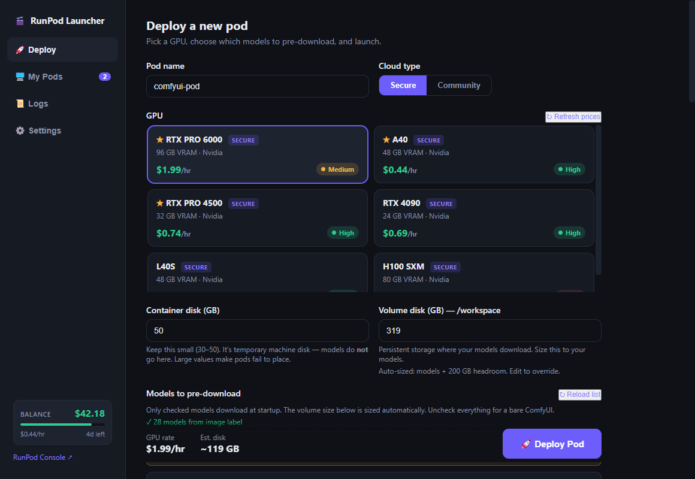
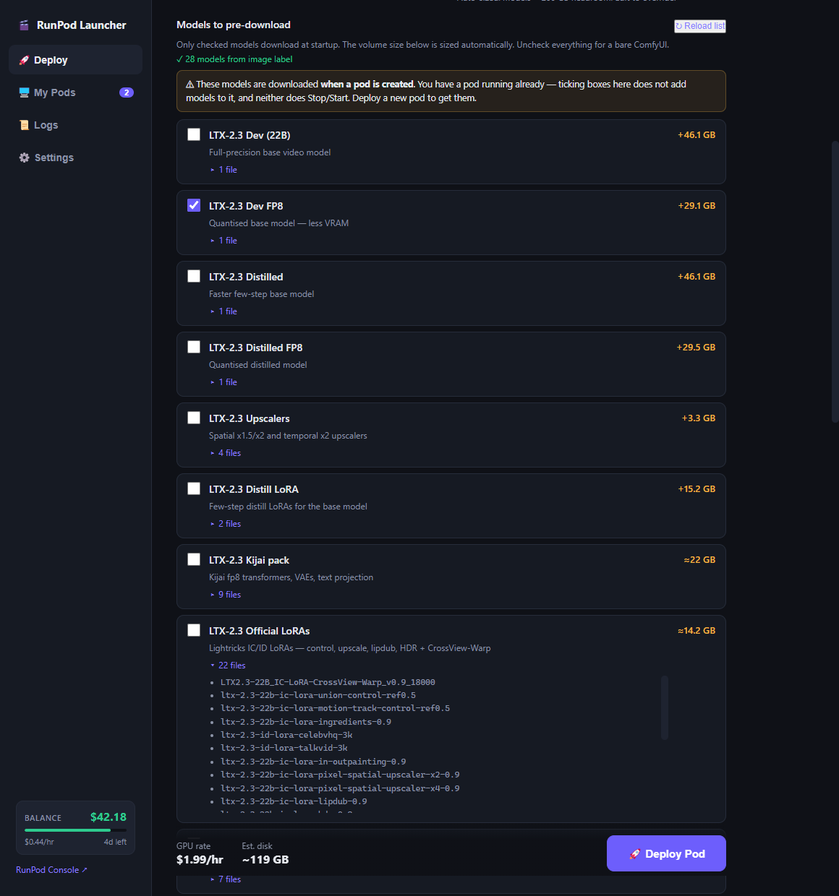
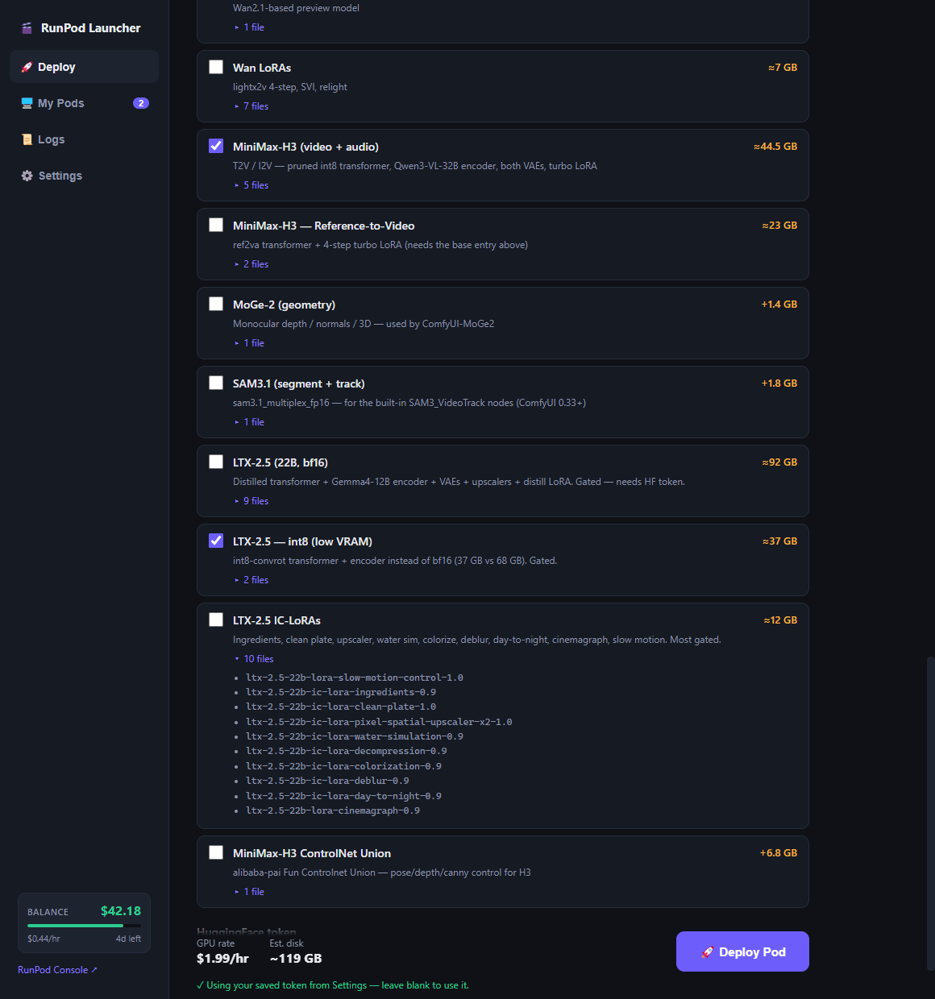
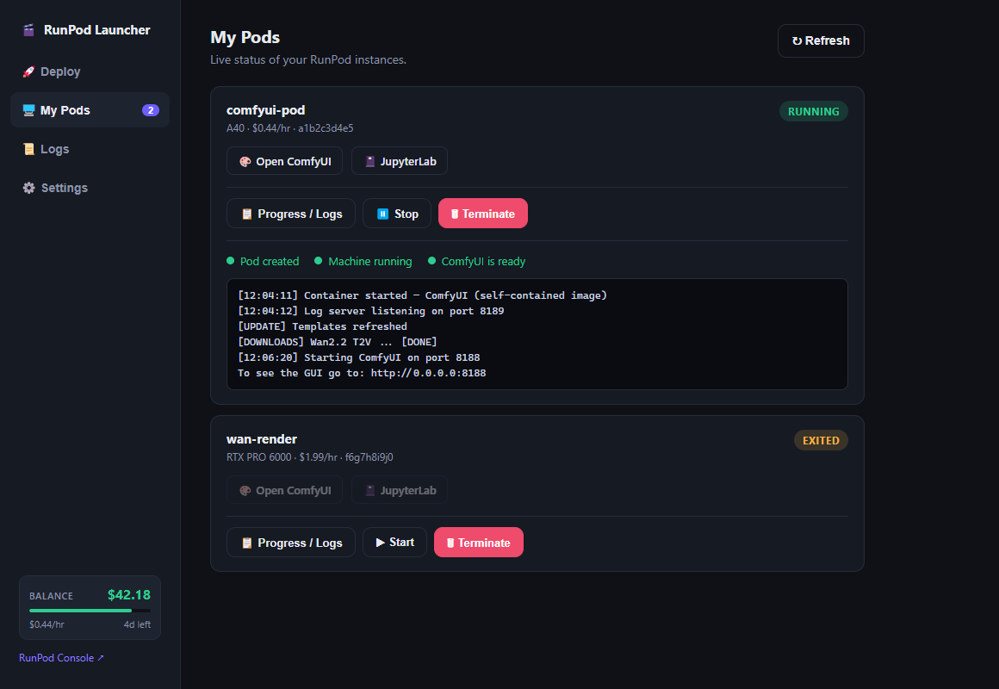
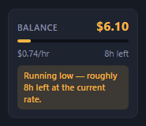
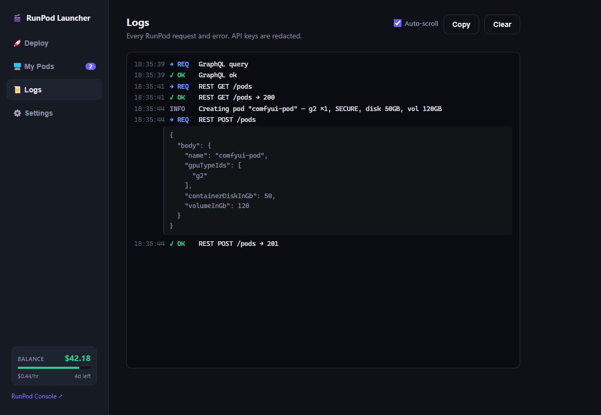
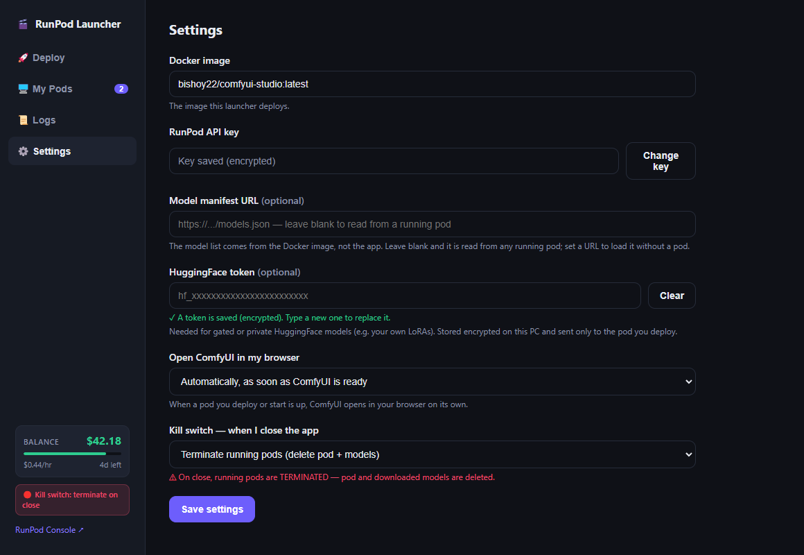

# ComfyUI RunPod Launcher

A friendly Windows desktop app to deploy a **ComfyUI GPU pod on RunPod** in one
click — pick a GPU with live pricing and availability, choose which AI models to
pre-download, launch, then open ComfyUI, watch progress, and stop or terminate
the pod. All from one window.


[](https://github.com/BISAM20/comfyui-runpod-launcher/releases/latest)

---

**[Download](#download)** · **[Screenshots](#screenshots)** ·
**[Features](#features)** · **[Getting started](#getting-started)** ·
**[Images](#the-docker-images-it-deploys)** ·
**[Studio models & workflows](#comfyui-studio--models--workflows)** ·
**[Model catalog](#model-catalog-modelsjson)** ·
**[Build from source](#build-from-source)** ·
**[Version history](#version-history)** ·
**[Code signing policy](#code-signing-policy)**

---

## Download

**[⬇ Download the latest installer](https://github.com/BISAM20/comfyui-runpod-launcher/releases/latest)**

Run `ComfyUI RunPod Launcher Setup.exe` and follow the installer. Because the app
is not yet code-signed, Windows SmartScreen may show a warning the first time —
click **More info → Run anyway**.

> Requires a [RunPod](https://runpod.io) account and an API key. The app runs
> locally on Windows 10/11; nothing is installed on your RunPod side beyond the
> pods you deploy.

---

## Screenshots

### Deploy — live GPU pricing & availability


### Model packs — see what's inside, volume sized for you


Every pack expands to the exact files it downloads. The volume disk is sized from
what you tick (plus 200 GB of headroom), and a notice reminds you that models are
applied when a pod is **created** — ticking them cannot change a pod that is
already running.

### Newest models — LTX-2.5, MiniMax-H3 and tools


### My Pods — live status, progress and container logs


### Cost meter — warns before you run out of credit


Balance, hourly burn rate and runtime left sit in the sidebar. It turns amber and
then red, and says how long you have left at the current rate.

### Logs — every request, with secrets redacted


### Settings — auto-open, manifest URL, HuggingFace token and kill switch


---

## Features

- **Live GPU pricing & availability** — only shows GPUs that are actually
  available, with High / Medium / Low badges and per-hour prices pulled straight
  from RunPod. Favourite GPUs pin to the top.
- **Cost meter** — live account balance, hourly burn rate, and estimated runtime
  remaining, with clear warnings before you run out of credit.
- **ComfyUI opens by itself** — once a pod you deploy or start is up, ComfyUI opens
  in your default browser automatically, optionally after the model downloads have
  finished. No need to visit My Pods and click Open ComfyUI.
- **One-click deploy** — name the pod, pick Secure or Community, choose which
  models to pre-download, and launch. Container-disk guardrails prevent the
  common "machine does not have the resources" placement failure.
- **Automatic volume sizing** — the volume disk is sized from the models you
  select, plus 200 GB of headroom. Override it any time.
- **Model list comes from the image** — the downloadable models are published by
  the Docker image itself, so pointing the app at a different image changes the
  list to match. Each pack can be expanded to show exactly which files and LoRAs
  it contains before you download it.
- **HuggingFace token** — saved encrypted for gated or private models.
- **Pod management** — live status, direct **Open ComfyUI** and **JupyterLab**
  links, and **Stop** / **Start** / **Terminate** controls.
- **Progress / Logs** — a per-pod panel with a boot timeline, ComfyUI-readiness
  probe, and streaming container logs (image boot + model-download progress).
- **App request log** — every RunPod API call and error, with API keys and
  tokens automatically redacted.
- **Kill switch** — optionally stop or terminate running pods when the app is
  closed so nothing is left billing (off by default).
- **Encrypted key storage** — the RunPod API key is stored encrypted on the
  local machine (Windows DPAPI) and is only ever sent to RunPod.

---

## Getting started

1. Create a RunPod API key at
   [console.runpod.io/user/settings](https://console.runpod.io/user/settings) →
   **API Keys** → **+ Create API Key** (read/write).
2. Launch the app and paste the key on the first screen.
3. **Deploy** tab — name the pod, pick a GPU, tick the models to pre-download,
   then **Deploy Pod**.
4. ComfyUI opens in your browser on its own as soon as the pod is ready (change
   this in **Settings**). You can also click **Open ComfyUI** on the **My Pods** tab.

**Stop vs Terminate:** *Stop* pauses billing and keeps downloaded models on the
volume; *Terminate* deletes the pod and its models. The app confirms before
terminating.

---

## The Docker images it deploys

Any ComfyUI image that uses `DOWNLOAD_*` environment variables works. Two are
maintained for this launcher — set one in **Settings → Docker image**:

| Image | Focus |
|---|---|
| `bishoy22/comfyui-studio:latest` | LTX-2.5 · MiniMax-H3 · LTX-2.3 · Krea 2 · FLUX.2 Klein · Wan 2.x |
| `bishoy22/comfyui-wan:latest` | Wan 2.1 / 2.2 video + LTX-2.3 |

Both are self-contained (ComfyUI installed directly on a CUDA base, launched by
their own `start.sh`) and expose:

| Port | Service |
|---|---|
| `8188` | ComfyUI |
| `8888` | JupyterLab |
| `8189` | Read-only log server (powers the in-app Progress / Logs panel) |

Models are downloaded on demand via `DOWNLOAD_*` environment variables the app
sets for you, and are stored on the pod's `/workspace` volume so they survive
Stop/Start.

---

## `comfyui-studio` — models & workflows

The image ships ComfyUI, the custom nodes and the workflows. **Models are not baked in** — they download only when you tick them, so a pod starts lean. All 28 packs together are **~635 GB**; pick per project and the app sizes the volume for you.

> **New in the image:** **LTX-2.5** (bf16, int8 and IC-LoRAs), **MiniMax-H3** (video + audio, reference-to-video, ControlNet Union), **MoGe-2** and **SAM3.1**. The LTX-2.3 Official LoRAs pack grew to 22 files (CrossView-Warp added) and Wan LoRAs is now 7 public files.


*The newest packs in the app — LTX-2.5, MiniMax-H3, MoGe-2 and SAM3.1, with the LTX-2.5 IC-LoRAs expanded to show every file.*

### Models

**LTX-2.5 — video  ·  new**

| Pack | What it is | Size | Files | HF token |
|---|---|---|---|---|
| **LTX-2.5 (22B, bf16)** | Distilled transformer + Gemma4-12B encoder + VAEs + upscalers + distill LoRA. Gated — needs HF token. | ~92 GB | 9 | 8 of 9 files |
| **LTX-2.5 — int8 (low VRAM)** | int8-convrot transformer + encoder instead of bf16 (37 GB vs 68 GB). Gated. | ~37 GB | 2 | required |
| **LTX-2.5 IC-LoRAs** | Ingredients, clean plate, upscaler, water sim, colorize, deblur, day-to-night, cinemagraph, slow motion. Most gated. | ~12 GB | 10 | 9 of 10 files |

**MiniMax-H3 — video + audio  ·  new**

| Pack | What it is | Size | Files | HF token |
|---|---|---|---|---|
| **MiniMax-H3 (video + audio)** | T2V / I2V — pruned int8 transformer, Qwen3-VL-32B encoder, both VAEs, turbo LoRA | ~44.5 GB | 5 | — |
| **MiniMax-H3 — Reference-to-Video** | ref2va transformer + 4-step turbo LoRA (needs the base entry above) | ~23 GB | 2 | — |
| **MiniMax-H3 ControlNet Union** | alibaba-pai Fun Controlnet Union — pose/depth/canny control for H3 | 6.8 GB | 1 | — |

**LTX-2.3 — video**

| Pack | What it is | Size | Files | HF token |
|---|---|---|---|---|
| **LTX-2.3 Dev (22B)** | Full-precision base video model | 46.1 GB | 1 | — |
| **LTX-2.3 Dev FP8** | Quantised base model — less VRAM | 29.1 GB | 1 | — |
| **LTX-2.3 Distilled** | Faster few-step base model | 46.1 GB | 1 | — |
| **LTX-2.3 Distilled FP8** | Quantised distilled model | 29.5 GB | 1 | — |
| **LTX-2.3 Upscalers** | Spatial x1.5/x2 and temporal x2 upscalers | 3.3 GB | 4 | — |
| **LTX-2.3 Distill LoRA** | Few-step distill LoRAs for the base model | 15.2 GB | 2 | — |
| **LTX-2.3 Kijai pack** | Kijai fp8 transformers, VAEs, text projection | ~22 GB | 9 | — |
| **LTX-2.3 Official LoRAs** | Lightricks IC/ID LoRAs — control, upscale, lipdub, HDR + CrossView-Warp | ~14.2 GB | 22 | 16 of 22 files |
| **LTX-2.3 Community LoRAs** | Community styles + Gemma abliterated encoders | 5.3 GB | 7 | — |

**Krea 2 — image**

| Pack | What it is | Size | Files | HF token |
|---|---|---|---|---|
| **Krea 2 Turbo** | Fast image model — fp8 + int8 | 26.6 GB | 2 | — |
| **Krea 2 RAW** | Photographic RAW model + turbo LoRA | 13.6 GB | 2 | — |
| **Krea 2 LoRAs** | Style LoRAs (darkbrush, neon drip, retro anime, watercolor, vintage tarot ...) + Turbo LoRA | ~4 GB | 11 | — |

**FLUX.2 Klein — image**

| Pack | What it is | Size | Files | HF token |
|---|---|---|---|---|
| **FLUX.2 Klein 9B (fp8)** | Klein 9B image model, fp8 + base. Gated — needs HF token + accepted licence. | ~20 GB | 2 | required |
| **FLUX.2 Klein 9B (bf16)** | Full-precision Klein 9B. Gated — needs HF token + accepted licence. | ~34 GB | 1 | required |
| **FLUX.2 Klein extras** | BiRefNet, SeedVR2, VAE, ref-control, BFS head | 10.1 GB | 5 | — |

**Wan 2.x — video**

| Pack | What it is | Size | Files | HF token |
|---|---|---|---|---|
| **Wan 2.2 Text-to-Video** | High + low noise fp8 (14B) | 28.6 GB | 2 | — |
| **Wan 2.2 Image-to-Video** | High + low noise fp8 (14B) | 28.6 GB | 2 | — |
| **Wan Animate v2** | Animate 14B fp8 + YOLO/ViTPose detection | 18.6 GB | 3 | — |
| **Mocha (preview)** | Wan2.1-based preview model | 14.3 GB | 1 | — |
| **Wan LoRAs** | lightx2v 4-step, SVI, relight | ~7 GB | 7 | — |

**Tools — geometry & segmentation  ·  new**

| Pack | What it is | Size | Files | HF token |
|---|---|---|---|---|
| **MoGe-2 (geometry)** | Monocular depth / normals / 3D — used by ComfyUI-MoGe2 | 1.4 GB | 1 | — |
| **SAM3.1 (segment + track)** | sam3.1_multiplex_fp16 — for the built-in SAM3_VideoTrack nodes (ComfyUI 0.33+) | 1.8 GB | 1 | — |

Sizes marked `~` are estimates — the source repository is gated or the size could not be measured. The **HF token** column shows packs that download from gated HuggingFace repositories: accept each repository's licence with your HuggingFace account and set the token once in **Settings**. Files you don't have access to are skipped and logged as `[SKIP] HF_TOKEN not set`; every other pack downloads without a token.

#### Every file, pack by pack

Each pack expands to the exact files it downloads — 117 files in total.

<details>
<summary><b>LTX-2.5 (22B, bf16)</b> — Distilled transformer + Gemma4-12B encoder + VAEs + upscalers + distill LoRA. Gated — needs HF token. · ~92 GB · 9 files</summary>

- `ltx-2.5-22b-distilled-transformer-bf16`
- `gemma4-12b-with-proj-ltx-2.5-bf16`
- `gemma4_e2b_it_bf16`
- `ltx-2.5-video-vae-bf16`
- `ltx-2.5-audio-vae-bf16`
- `ltx-2.5-latent-spatial-upscaler-x2-bf16-1.0`
- `ltx-2.5-latent-temporal-upscaler-x2-bf16-1.0`
- `ltx-2.5-duration-head-bf16`
- `ltx-2.5-22b-distilled-lora-450-bf16`

</details>

<details>
<summary><b>LTX-2.5 — int8 (low VRAM)</b> — int8-convrot transformer + encoder instead of bf16 (37 GB vs 68 GB). Gated. · ~37 GB · 2 files</summary>

- `ltx-2.5-22b-distilled-transformer-comfy-int8-convrot`
- `gemma4-12b-with-proj-ltx-2.5-comfy-int8-convrot`

</details>

<details>
<summary><b>LTX-2.5 IC-LoRAs</b> — Ingredients, clean plate, upscaler, water sim, colorize, deblur, day-to-night, cinemagraph, slow motion. Most gated. · ~12 GB · 10 files</summary>

- `ltx-2.5-22b-lora-slow-motion-control-1.0`
- `ltx-2.5-22b-ic-lora-ingredients-0.9`
- `ltx-2.5-22b-ic-lora-clean-plate-1.0`
- `ltx-2.5-22b-ic-lora-pixel-spatial-upscaler-x2-1.0`
- `ltx-2.5-22b-ic-lora-water-simulation-0.9`
- `ltx-2.5-22b-ic-lora-decompression-0.9`
- `ltx-2.5-22b-ic-lora-colorization-0.9`
- `ltx-2.5-22b-ic-lora-deblur-0.9`
- `ltx-2.5-22b-ic-lora-day-to-night-0.9`
- `ltx-2.5-22b-lora-cinemagraph-0.9`

</details>

<details>
<summary><b>MiniMax-H3 (video + audio)</b> — T2V / I2V — pruned int8 transformer, Qwen3-VL-32B encoder, both VAEs, turbo LoRA · ~44.5 GB · 5 files</summary>

- `minimax_h3_fl2va_pruned_int8_convrot`
- `qwen3vl_32b_minimax_h3_nvfp4_awq`
- `minimax_h3_video_vae_fp16`
- `minimax_h3_audio_vae_fp32`
- `minimax_h3_fl2v_turbo_8step_v1.0`

</details>

<details>
<summary><b>MiniMax-H3 — Reference-to-Video</b> — ref2va transformer + 4-step turbo LoRA (needs the base entry above) · ~23 GB · 2 files</summary>

- `minimax_h3_ref2va_pruned_int8_convrot`
- `minimax_h3_ref2v_turbo_4step_v0.1`

</details>

<details>
<summary><b>MiniMax-H3 ControlNet Union</b> — alibaba-pai Fun Controlnet Union — pose/depth/canny control for H3 · 6.8 GB · 1 files</summary>

- `MiniMax-H3-Fun-Controlnet-Union`

</details>

<details>
<summary><b>LTX-2.3 Dev (22B)</b> — Full-precision base video model · 46.1 GB · 1 files</summary>

- `ltx-2.3-22b-dev`

</details>

<details>
<summary><b>LTX-2.3 Dev FP8</b> — Quantised base model — less VRAM · 29.1 GB · 1 files</summary>

- `ltx-2.3-22b-dev-fp8`

</details>

<details>
<summary><b>LTX-2.3 Distilled</b> — Faster few-step base model · 46.1 GB · 1 files</summary>

- `ltx-2.3-22b-distilled-1.1`

</details>

<details>
<summary><b>LTX-2.3 Distilled FP8</b> — Quantised distilled model · 29.5 GB · 1 files</summary>

- `ltx-2.3-22b-distilled-fp8`

</details>

<details>
<summary><b>LTX-2.3 Upscalers</b> — Spatial x1.5/x2 and temporal x2 upscalers · 3.3 GB · 4 files</summary>

- `ltx-2.3-spatial-upscaler-x2-1.1`
- `ltx-2.3-spatial-upscaler-x2-1.0`
- `ltx-2.3-spatial-upscaler-x1.5-1.0`
- `ltx-2.3-temporal-upscaler-x2-1.0`

</details>

<details>
<summary><b>LTX-2.3 Distill LoRA</b> — Few-step distill LoRAs for the base model · 15.2 GB · 2 files</summary>

- `ltx-2.3-22b-distilled-lora-384-1.1`
- `ltx-2.3-22b-distilled-lora-384`

</details>

<details>
<summary><b>LTX-2.3 Kijai pack</b> — Kijai fp8 transformers, VAEs, text projection · ~22 GB · 9 files</summary>

- `ltx-2.3-22b-dev_transformer_only_fp8_scaled`
- `ltx-2.3-22b-distilled_transformer_only_fp8_input_scaled_v3`
- `ltx-2.3_text_projection_bf16`
- `LTX23_video_vae_bf16`
- `LTX23_audio_vae_bf16`
- `taeltx2_3`
- `ltx-2.3-22b-distilled-1.1_lora-dynamic_fro09_avg_rank_111_bf16`
- `ltx-2.3-22b-distilled-lora-dynamic_fro09_avg_rank_105_bf16`
- `LTX-2.3-OmniNFT-RL-Lora_bf16`

</details>

<details>
<summary><b>LTX-2.3 Official LoRAs</b> — Lightricks IC/ID LoRAs — control, upscale, lipdub, HDR + CrossView-Warp · ~14.2 GB · 22 files</summary>

- `LTX2.3-22B_IC-LoRA-CrossView-Warp_v0.9_18000`
- `ltx-2.3-22b-ic-lora-union-control-ref0.5`
- `ltx-2.3-22b-ic-lora-motion-track-control-ref0.5`
- `ltx-2.3-22b-ic-lora-ingredients-0.9`
- `ltx-2.3-id-lora-celebvhq-3k`
- `ltx-2.3-id-lora-talkvid-3k`
- `ltx-2.3-22b-ic-lora-in-outpainting-0.9`
- `ltx-2.3-22b-ic-lora-pixel-spatial-upscaler-x2-0.9`
- `ltx-2.3-22b-ic-lora-pixel-spatial-upscaler-x4-0.9`
- `ltx-2.3-22b-ic-lora-lipdub-0.9`
- `ltx-2.3-22b-ic-lora-hdr-0.9`
- `ltx-2.3-22b-ic-lora-hdr-scene-emb`
- `ltx-2.3-22b-ic-lora-instant-shave-0.9`
- `ltx-2.3-22b-ic-lora-clean-plate-1.0`
- `ltx-2.3-22b-ic-lora-colorization-0.9`
- `ltx-2.3-22b-ic-lora-day-to-night-0.9`
- `ltx-2.3-22b-ic-lora-deblur-0.9`
- `ltx-2.3-22b-ic-lora-decompression-0.9`
- `ltx-2.3-22b-ic-lora-water-simulation-0.9`
- `ltx-2.3-22b-ic-lora-cross-eyed-0.9`
- `ltx-2.3-22b-lora-cinemagraph-0.9`
- `ltx-2.3-22b-lora-foley-v2a-1.0`

</details>

<details>
<summary><b>LTX-2.3 Community LoRAs</b> — Community styles + Gemma abliterated encoders · 5.3 GB · 7 files</summary>

- `googlyeyes-ltx-2.3-rank32-step03000`
- `ltx-2.3-22b-ic-lora-outpaint`
- `lora_weights_step_05000`
- `LTX23_Obscura_Remova_v1`
- `ltx2.3-transition`
- `gemma-3-12b-it-abliterated_lora_rank64_bf16`
- `gemma-3-12b-it-abliterated_heretic_lora_rank64_bf16`

</details>

<details>
<summary><b>Krea 2 Turbo</b> — Fast image model — fp8 + int8 · 26.6 GB · 2 files</summary>

- `krea2_turbo_fp8_scaled`
- `krea2_turbo_int8_convrot`

</details>

<details>
<summary><b>Krea 2 RAW</b> — Photographic RAW model + turbo LoRA · 13.6 GB · 2 files</summary>

- `krea2_raw_fp8_scaled`
- `krea2_turbo_lora_rank_64_bf16`

</details>

<details>
<summary><b>Krea 2 LoRAs</b> — Style LoRAs (darkbrush, neon drip, retro anime, watercolor, vintage tarot ...) + Turbo LoRA · ~4 GB · 11 files</summary>

- `krea2_style_reference`
- `krea2_darkbrush`
- `krea2_dotmatrix`
- `krea2_kidsdrawing`
- `krea2_neondrip`
- `krea2_rainywindow`
- `krea2_retroanime`
- `krea2_softwatercolor`
- `krea2_sunsetblur`
- `krea2_vintagetarot`
- `krea2_turbo_lora_rank_64_bf16`

</details>

<details>
<summary><b>FLUX.2 Klein 9B (fp8)</b> — Klein 9B image model, fp8 + base. Gated — needs HF token + accepted licence. · ~20 GB · 2 files</summary>

- `flux-2-klein-9b-fp8`
- `flux-2-klein-base-9b-fp8`

</details>

<details>
<summary><b>FLUX.2 Klein 9B (bf16)</b> — Full-precision Klein 9B. Gated — needs HF token + accepted licence. · ~34 GB · 1 files</summary>

- `flux-2-klein-9b`

</details>

<details>
<summary><b>FLUX.2 Klein extras</b> — BiRefNet, SeedVR2, VAE, ref-control, BFS head · 10.1 GB · 5 files</summary>

- `birefnet`
- `seedvr2_7b_int8_convrot`
- `ema_vae_fp16`
- `refcontrol_v2_poses`
- `bfs_head_v1_flux-klein_9b_step3500_rank128`

</details>

<details>
<summary><b>Wan 2.2 Text-to-Video</b> — High + low noise fp8 (14B) · 28.6 GB · 2 files</summary>

- `wan2.2_t2v_high_noise_14B_fp8_scaled`
- `wan2.2_t2v_low_noise_14B_fp8_scaled`

</details>

<details>
<summary><b>Wan 2.2 Image-to-Video</b> — High + low noise fp8 (14B) · 28.6 GB · 2 files</summary>

- `wan2.2_i2v_high_noise_14B_fp8_scaled`
- `wan2.2_i2v_low_noise_14B_fp8_scaled`

</details>

<details>
<summary><b>Wan Animate v2</b> — Animate 14B fp8 + YOLO/ViTPose detection · 18.6 GB · 3 files</summary>

- `Wan2_2-Animate-14B_fp8_scaled_e4m3fn_KJ_v2`
- `yolov10m`
- `vitpose-l-wholebody`

</details>

<details>
<summary><b>Mocha (preview)</b> — Wan2.1-based preview model · 14.3 GB · 1 files</summary>

- `Wan2_1_mocha-14B-preview_fp8_e4m3fn_scaled_KJ`

</details>

<details>
<summary><b>Wan LoRAs</b> — lightx2v 4-step, SVI, relight · ~7 GB · 7 files</summary>

- `wan2.2_animate_14B_relight_lora_bf16`
- `high_noise_model`
- `low_noise_model`
- `wan2.2_i2v_A14b_high_noise_lora_rank64_lightx2v_4step_1022`
- `wan2.2_i2v_A14b_low_noise_lora_rank64_lightx2v_4step_1022`
- `SVI_v2_PRO_Wan2.2-I2V-A14B_HIGH_lora_rank_128_fp16`
- `SVI_v2_PRO_Wan2.2-I2V-A14B_LOW_lora_rank_128_fp16`

</details>

<details>
<summary><b>MoGe-2 (geometry)</b> — Monocular depth / normals / 3D — used by ComfyUI-MoGe2 · 1.4 GB · 1 files</summary>

- `moge-2-vitl-normal`

</details>

<details>
<summary><b>SAM3.1 (segment + track)</b> — sam3.1_multiplex_fp16 — for the built-in SAM3_VideoTrack nodes (ComfyUI 0.33+) · 1.8 GB · 1 files</summary>

- `sam3.1_multiplex_fp16`

</details>

### Workflows

79 workflows across 12 folders are baked into ComfyUI's **Workflows** panel. They are listed as published upstream today, and are refreshed on every pod start (`AUTO_UPDATE_TEMPLATES=false` disables that), so new upstream workflows appear without rebuilding the image.

<details>
<summary><b>LTX-2.5/</b> — official Lightricks examples · new · 12 workflows</summary>

- `LTX-2.5_T2V_I2V_Single_Stage_Distilled` — text/image → video, one stage
- `LTX-2.5_T2V_I2V_Two_Stage_Distilled` — text/image → video, two stage
- `LTX-2.5_A2V_Two_Stage_Distilled` — audio → video
- `LTX-2.5_T2A_Single_Stage_Distilled` — text → audio
- `LTX-2.5_V2V_ICLoRA_Single_Stage_Distilled` — video → video
- `LTX-2.5_V2V_TiledFusion_Upscale` — tiled video upscale
- `LTX-2.5_V2V_TiledFusion_Native_4K_8K` — tiled native 4K / 8K
- `LTX-2.5_ICLoRA_Union_Control_Distilled` — union control
- `LTX-2.5_ICLoRA_Motion_Track_Distilled` — motion tracking
- `LTX-2.5_ICLoRA_Ingredients_Single_Stage_Distilled` — ingredients / reference
- `LTX-2.5_ICLoRA_Inpaint_Two_Stage_Distilled` — inpainting
- `LTX-2.5_ICLoRA_Outpaint_Two_Stage_Distilled` — outpainting

</details>

<details>
<summary><b>LTX-2.5-community/</b> — Comfy-Org templates · new · 3 workflows</summary>

- `video_ltx2_5_t2v` — text → video
- `video_ltx2_5_i2v` — image → video
- `video_ltx2_5_flf2v` — first + last frame → video

</details>

<details>
<summary><b>MiniMax-H3/</b> — Comfy-Org templates · new · 6 workflows</summary>

- `video_minimax_h3_t2v` — text → video
- `video_minimax_h3_i2v` — image → video
- `video_minimax_h3_i2v_continuation` — image → video, continuation
- `video_minimax_h3_r2v` — reference → video
- `video_minimax_h3_multiframe_reference` — multi-frame reference
- `video_minimax_h3_fun_controlnet_union` — ControlNet Union (pose / depth / canny)

</details>

<details>
<summary><b>LTX-2.3/</b> — official Lightricks examples · 12 workflows</summary>

- `LTX-2.3_T2V_I2V_Single_Stage_Distilled_Full` — text/image → video, one stage
- `LTX-2.3_T2V_I2V_Two_Stage_Distilled` — text/image → video, two stage
- `LTX-2.3_V2V_ICLoRA_Single_Stage_Distilled` — video → video
- `LTX-2.3_T2A_Single_Stage_Distilled` — text → audio
- `LTX-2.3_ICLoRA_Union_Control_Distilled` — union control
- `LTX-2.3_ICLoRA_Motion_Track_Distilled` — motion tracking
- `LTX-2.3_ICLoRA_Ingredients_Single_Stage_Distilled` — ingredients / reference
- `LTX-2.3_ICLoRA_Inpaint_Two_Stage_Distilled` — inpainting
- `LTX-2.3_ICLoRA_Outpaint_Two_Stage_Distilled` — outpainting
- `LTX-2.3_ICLoRA_DubIt_Two_Stage_Distilled` — DubIt, two stage
- `LTX-2.3_ICLoRA_HDR_Distilled` — HDR
- `LTX-2.3_ICLoRA_Pixel_Spatial_Upscaler_Distilled` — pixel spatial upscale

</details>

<details>
<summary><b>LTX-2.3-community/</b> — Comfy-Org templates · 8 workflows</summary>

- `template_ltx2_3_ic_lora_ingredients`
- `template_ltx2_3_lora_googly_eyes`
- `template_ltx2_3_lora_remove_subtitles_from_video`
- `template_ltx2_3_lora_restore_archival_footage`
- `template_ltx2_3_lora_video_outpainting`
- `template_ltx2_3_obscura_remova_lora_remove_object_from_video`
- `template_ltx2_3_remove_watermark_from_video`
- `template_ltx2_3_style_transition`

</details>

<details>
<summary><b>WhatDreamsCost/</b> — LTX Director / first-last-frame · 5 workflows</summary>

- `LTX_Director_2_Workflow_Distilled`
- `LTX_Director_2_Workflow_GGUF`
- `LTX I2V First Last Frame 2 Stage Workflow v6`
- `LTX I2V First Last Frame 3 Stage Workflow v6`
- `LTX I2V FFLF Custom Audio Workflow - SUPPORTS LATEST COMFYUI VERSION - V3`

</details>

<details>
<summary><b>Krea2/</b> — Comfy-Org templates · 3 workflows</summary>

- `image_krea2_turbo_t2i` — text → image
- `image_krea2_turbo_t2i_int8` — text → image, int8
- `image_krea2_turbo_int8_image_style_reference` — style reference

</details>

<details>
<summary><b>FLUX2-Klein/</b> — one-node pipeline, NKD tools, Comfy-Org · 16 workflows</summary>

- `t2i_workflow` — one-node · text → image
- `i2i_workflow` — one-node · image → image
- `edit_workflow` — one-node · instruction edit
- `inpaint_workflow` — one-node · inpainting
- `outpaint_workflow` — one-node · outpainting
- `faceswap_workflow` — one-node · face swap
- `pose_workflow` — one-node · pose control
- `remove_bg_workflow` — one-node · background removal
- `upscale_workflow` — one-node · upscale
- `NKD Klein Tools` — NKD Klein Tools
- `image_flux2_klein_text_to_image` — Comfy-Org · text → image
- `image_flux2_klein_9b_kv_image_edit` — Comfy-Org · 9B KV image edit
- `image_flux2_klein_image_edit_9b_base` — Comfy-Org · 9B base edit
- `image_flux2_klein_image_edit_9b_distilled` — Comfy-Org · 9B distilled edit
- `image_flux2_klein_image_edit_4b_base` — Comfy-Org · 4B base edit
- `image_flux2_klein_image_edit_4b_distilled` — Comfy-Org · 4B distilled edit

</details>

<details>
<summary><b>Wan2.2/</b> — Hearmeman · 9 workflows</summary>

- `Wan2.2_T2V` — text → video
- `Wan2.2_I2V` — image → video
- `Wan2.2_T2V_60FPS` — 60 fps
- `Wan2.2_I2V_60FPS` — 60 fps
- `Wan2.2_T2V_RES4LYF_Nodes` — slower, better quality
- `Wan2.2_I2V_RES4LYF_Nodes` — slower, better quality
- `Wan2.2_5B_T2V_60FPS` — faster, 5B model
- `Wan2.2_5B_I2V_60FPS` — faster, 5B model
- `Wan2.2_Text-To-Image` — text → image

</details>

<details>
<summary><b>Wan-Animate/</b> — Hearmeman + KJ · 4 workflows</summary>

- `Wan_Animate_V2_HearmemanAI`
- `Wan_Animate_Replace_Person`
- `wanvideo_WanAnimate_example_01`
- `wanvideo_WanAnimate_preprocess_example_02`

</details>

<details>
<summary><b>Wan-MoCha/</b> — KJ wrapper · 1 workflows</summary>

- `wanvideo_2_1_14B_MoCha_replace_subject_KJ_02` — replace subject

</details>

<details>
<summary><b>LTX-Video-other/</b> — earlier LTX-Video examples</summary>

The remaining top-level examples shipped with `ComfyUI-LTXVideo`, kept for reference. The versioned `2.3/` and `2.5/` sets above are the current ones.

</details>

### Custom nodes

All 41 nodes installed in the image, each at its latest upstream commit when the image is built.

**Video & audio**

| Node | Author | What it does |
|---|---|---|
| [ComfyUI-LTXVideo](https://github.com/Lightricks/ComfyUI-LTXVideo) | Lightricks | LTX-2.x video nodes |
| [WhatDreamsCost-ComfyUI](https://github.com/WhatDreamsCost/WhatDreamsCost-ComfyUI) | WhatDreamsCost | LTX Director and first/last-frame workflows |
| [ComfyUI-CrossViewWarp](https://github.com/cseti007/ComfyUI-CrossViewWarp) | cseti007 | CrossView-Warp nodes |
| [ComfyUI-WanVideoWrapper](https://github.com/kijai/ComfyUI-WanVideoWrapper) | kijai | Wan 2.x video wrapper |
| [ComfyUI-WanAnimatePreprocess](https://github.com/kijai/ComfyUI-WanAnimatePreprocess) | kijai | Wan Animate preprocessing |
| [ComfyUI-VideoHelperSuite](https://github.com/Kosinkadink/ComfyUI-VideoHelperSuite) | Kosinkadink | Load, combine and preview video |
| [ComfyUI-Frame-Interpolation](https://github.com/Fannovel16/ComfyUI-Frame-Interpolation) | Fannovel16 | Frame interpolation (RIFE / FILM) |
| [ComfyUI-GIMM-VFI](https://github.com/kijai/ComfyUI-GIMM-VFI) | kijai | GIMM-VFI frame interpolation |
| [MaskVidExperiments](https://github.com/drozbay/MaskVidExperiments) | drozbay | Video mask experiments |
| [comfyui-hrnodes](https://github.com/hashu786/comfyui-hrnodes) | hashu786 | HR utility nodes |

**Image**

| Node | Author | What it does |
|---|---|---|
| [one-node-flux-2-klein](https://github.com/yanokusnir-ai/one-node-flux-2-klein) | yanokusnir-ai | One-node FLUX.2 Klein pipeline |
| [ComfyUI-NKD-Klein-Tools](https://github.com/Nekodificador/ComfyUI-NKD-Klein-Tools) | Nekodificador | FLUX.2 Klein tools |
| [ComfyUI-NKD-Basic-Tools](https://github.com/Nekodificador/ComfyUI-NKD-Basic-Tools) | Nekodificador | NKD basic tools |
| [ComfyUI-NKD-Sigmas-Curve](https://github.com/Nekodificador/ComfyUI-NKD-Sigmas-Curve) | Nekodificador | Sigma curve editor |
| [ComfyUI-NKD-Popup-Preview](https://github.com/Nekodificador/ComfyUI-NKD-Popup-Preview) | Nekodificador | Popup image preview |
| [ComfyUI-RMBG](https://github.com/1038lab/ComfyUI-RMBG) | 1038lab | Background removal |
| [ComfyUI-Inpaint-CropAndStitch](https://github.com/lquesada/ComfyUI-Inpaint-CropAndStitch) | lquesada | Inpaint crop and stitch |
| [ComfyUI_UltimateSDUpscale](https://github.com/ssitu/ComfyUI_UltimateSDUpscale) | ssitu | Tiled Ultimate SD Upscale |
| [ComfyUI-Detail-Daemon](https://github.com/Jonseed/ComfyUI-Detail-Daemon) | Jonseed | Detail enhancement |

**Vision, depth & segmentation**

| Node | Author | What it does |
|---|---|---|
| [ComfyUI-segment-anything-2](https://github.com/kijai/ComfyUI-segment-anything-2) | kijai | SAM 2 segmentation |
| [ComfyUI-Florence2](https://github.com/kijai/ComfyUI-Florence2) | kijai | Florence-2 vision-language model |
| [comfyui_controlnet_aux](https://github.com/Fannovel16/comfyui_controlnet_aux) | Fannovel16 | ControlNet preprocessors |
| [ComfyUI-DepthAnythingV2](https://github.com/kijai/ComfyUI-DepthAnythingV2) | kijai | Depth Anything V2 |
| [ComfyUI-DepthAnythingV3](https://github.com/PozzettiAndrea/ComfyUI-DepthAnythingV3) | PozzettiAndrea | Depth Anything V3 |
| [ComfyUI-DepthCrafter-Nodes](https://github.com/akatz-ai/ComfyUI-DepthCrafter-Nodes) | akatz-ai | Consistent video depth |
| [ComfyUI-MoGe2](https://github.com/zade23/ComfyUI-MoGe2) | zade23 | MoGe-2 geometry (depth / normals / 3D) |

**Utilities & workflow**

| Node | Author | What it does |
|---|---|---|
| [ComfyUI-Manager](https://github.com/ltdrdata/ComfyUI-Manager) | ltdrdata | Install nodes and models from the UI |
| [ComfyUI-Impact-Pack](https://github.com/ltdrdata/ComfyUI-Impact-Pack) | ltdrdata | Detection, segmentation and switch logic |
| [was-node-suite-comfyui](https://github.com/ltdrdata/was-node-suite-comfyui) | ltdrdata | WAS node suite |
| [ComfyUI-KJNodes](https://github.com/kijai/ComfyUI-KJNodes) | kijai | Utility nodes (resize, constants, NAG) |
| [ComfyUI-Easy-Use](https://github.com/yolain/ComfyUI-Easy-Use) | yolain | Simplified pipelines |
| [ComfyUI_essentials](https://github.com/cubiq/ComfyUI_essentials) | cubiq | Core utility nodes |
| [rgthree-comfy](https://github.com/rgthree/rgthree-comfy) | rgthree | Labels, bookmarks and display nodes |
| [ComfyUI-Custom-Scripts](https://github.com/pythongosssss/ComfyUI-Custom-Scripts) | pythongosssss | UI helpers, Get/Set nodes, autocomplete |
| [ComfyUI-Logic](https://github.com/theUpsider/ComfyUI-Logic) | theUpsider | Conditional logic nodes |
| [cg-use-everywhere](https://github.com/chrisgoringe/cg-use-everywhere) | chrisgoringe | Broadcast values across the graph |
| [ComfyUI_Fill-Nodes](https://github.com/filliptm/ComfyUI_Fill-Nodes) | filliptm | Fill-Nodes utility set |
| [ComfyUI-Crystools](https://github.com/crystian/ComfyUI-Crystools) | crystian | Resource monitor and metadata |
| [ComfyUI-GGUF](https://github.com/city96/ComfyUI-GGUF) | city96 | GGUF quantised model loader |
| [RES4LYF](https://github.com/ClownsharkBatwing/RES4LYF) | ClownsharkBatwing | Advanced samplers and schedulers |
| [ComfyUI-advanced-model-manager](https://github.com/BISAM20/ComfyUI-advanced-model-manager) | BISAM20 | Model manager |

---

## Model catalog (`models.json`)

The list of downloadable models is defined by the **image**, not the app — point
the app at a different image and the model list changes to match. The catalog is
resolved in this order, all before any pod exists:

1. **Manifest URL** — if one is set in **Settings → Model manifest URL**.
2. **The image on Docker Hub** — a `com.comfyui.models` label carrying the full
   catalog (names, descriptions, sizes). Images without that label still work:
   the app reads their `DOWNLOAD_*` environment variables and lists those, with
   sizes shown as unknown.
3. **A running pod** on the same image, which serves `models.json` on port 8189.

If none are reachable, the app falls back to a small built-in list — but **only
for the image that list was written for**. For any other image it shows an error
instead of guessing, because a `DOWNLOAD_*` flag an image does not declare is
silently ignored by its `start.sh`: the pod would deploy and download nothing.

> **Models are applied when a pod is created.** RunPod cannot change a running
> pod's environment, so ticking models has no effect on an existing pod — not
> even across Stop/Start. Deploy a new pod to add models.

```json
{
  "models": [
    {
      "env": "DOWNLOAD_WAN22_T2V",
      "name": "Wan 2.2 — Text-to-Video",
      "desc": "High + low noise fp8 (14B)",
      "gb": 28.6,
      "items": [
        "wan2.2_t2v_high_noise_14B_fp8_scaled",
        "wan2.2_t2v_low_noise_14B_fp8_scaled"
      ]
    }
  ]
}
```

`items` is optional — when present, the app shows an expandable list so you can
see exactly which models and LoRAs a pack contains. `approx: true` marks a size
as an estimate.

Add a model to the image (a `DOWNLOAD_*` flag in `start.sh` plus an entry here),
run `node gen-label.js` to refresh the image label, rebuild, and it appears in
the app automatically.

---

## Build from source

Requires [Node.js](https://nodejs.org) (LTS).

```bash
npm install
npm start          # run in development
npm run dist       # build the Windows installer into release/
```

`npm run dist` produces `release/ComfyUI RunPod Launcher Setup <version>.exe`
(an NSIS installer). Double-clicking `Build Installer.bat` does the same.

### Project layout

| Path | Purpose |
|---|---|
| `electron/main.js` | Window, IPC, and all RunPod network calls (main process). |
| `electron/runpod.js` | RunPod client — REST for pods, GraphQL for GPU pricing. |
| `electron/store.js` | Encrypted API-key + settings storage. |
| `electron/logger.js` | In-app log bus with secret redaction. |
| `electron/preload.js` | Safe bridge exposed to the UI. |
| `renderer/` | UI — `index.html`, `styles.css`, `app.js`, `models.js`. |

`renderer/models.js` holds only the offline **fallback** catalog. The real model
list comes from the Docker image — see [Model catalog](#model-catalog-modelsjson)
above.

---

## Version history

Every release is listed here, newest first. Installers for all versions are on
the [releases page](https://github.com/BISAM20/comfyui-runpod-launcher/releases).

### v1.4.0 — ComfyUI opens by itself
**Added**
- **Auto-open ComfyUI.** Once a pod you deploy or start is up, ComfyUI opens in
  your default browser automatically — no more visiting My Pods and clicking
  *Open ComfyUI*. Choose in **Settings**: automatically when ComfyUI is ready
  (default), automatically once it is ready *and* the model downloads have
  finished, or never. The choice is saved, and changing it applies straight away,
  even to a pod that is still booting.
- The wait is careful: it needs two consecutive successful checks, so a single
  flicker does not open an empty page; it stops if the pod exits or is
  terminated; it gives up after 40 minutes (6 hours when waiting for downloads);
  and it opens once per start. An image that publishes no download logs is not
  waited on forever.
- Short notifications say when ComfyUI opened, or that it is waiting for
  downloads first.

**Fixed**
- The "models apply when a pod is created" notice no longer shows at startup, or
  stays up if the pod list cannot be loaded. It hid itself with an inline style
  the app's security policy blocks (introduced in v1.3.1).

### v1.3.2 — Bigger default volume
**Changed**
- Auto volume sizing now adds **200 GB** of headroom on top of the selected
  models, up from 50 GB. A pod with no models selected starts at 200 GB, and
  each model adds its own size — enough room for generated output and extra
  models pulled later from ComfyUI-Manager without resizing.
- Typing your own value still switches the field to manual; clear it to go back
  to automatic.

### v1.3.1 — Fix silently-ignored model selections
**Fixed**
- The built-in fallback model list was shown for **any** image when its manifest
  could not be read. Its `DOWNLOAD_*` flags belong to `comfyui-wan`; other images
  ignore unknown flags, so a pod deployed and downloaded nothing with no error.
  The fallback is now restricted to its own image, and other images show an
  explicit error with no model rows instead of flags that would do nothing.
- The model list no longer flashes the built-in list before the real catalog
  loads.

**Added**
- A warning on the Deploy tab whenever a pod already exists: models are applied
  **when a pod is created**, so ticking them cannot affect a running pod (RunPod
  cannot change a running pod's environment, not even across Stop/Start).

### v1.3.0 — See what's inside each model pack
**Added**
- Every model pack expands to list the exact models and LoRAs it downloads, so
  `LTX-2.3 Official LoRAs` is no longer an opaque flag name.
- Manifests gained an optional `items` array and an `approx` flag; estimated
  sizes display as `≈`.

**Changed**
- Packs published by an image show readable names, real descriptions and
  measured sizes instead of `LTX23 Loras — Declared by the image`.

### v1.2.1 — Model list follows the Docker image
**Fixed**
- The model list only refreshed from a running pod, so switching images kept
  showing the previous list. The catalog is now read from the image on Docker
  Hub before any pod exists — from a `com.comfyui.models` label when present,
  otherwise derived from the image's own `DOWNLOAD_*` environment variables.
- A running pod is only used as a catalog source when its image matches the one
  being deployed.
- Model names derived from environment variables are formatted properly
  (`LTX23 Dev FP8`, `WAN22 T2V`).

**Changed**
- Auto volume sizing assumes a conservative size for models with no published
  size rather than under-provisioning the volume (shown as `≥`).

### v1.2.0 — Cost meter, HuggingFace token, image-defined models
**Added**
- **Cost meter** — live account balance, hourly burn rate and estimated runtime
  remaining, with low-balance warnings.
- **HuggingFace token** — saved encrypted once in Settings and applied to every
  deploy, for gated or private models.
- **Model list from the Docker image** — the image publishes a `models.json`
  catalog the app reads, so updating the image updates the list.
- **Automatic volume sizing** — the volume disk is calculated from the selected
  models plus 50 GB of headroom (raised to 200 GB in v1.3.2); typing a value switches to manual.

### v1.1.0 — Availability, progress, and a kill switch
**Added**
- **Live GPU availability** — only available GPUs are listed, with High /
  Medium / Low badges; RTX PRO 6000, A40 and RTX PRO 4500 pin to the top.
- **Progress / Logs panel** — per-pod status timeline, ComfyUI-readiness probe
  and streaming container logs.
- **Logs tab** — every RunPod request and error, with secrets redacted.
- **Kill switch** — optionally stop or terminate running pods when the app
  closes (off by default).

**Fixed**
- Container-disk guardrails that prevent the common *"machine does not have the
  resources"* placement failure.

### v1.0.0 — First release
- Deploy a ComfyUI pod on RunPod: API key setup, GPU picker with live pricing,
  model pre-download selection, and Stop / Start / Terminate pod management.

---

## Notes

- The RunPod API key is stored encrypted locally and transmitted only to RunPod.
- The installer is currently **unsigned**, so Windows SmartScreen shows a warning on
  first run. See the [code signing policy](#code-signing-policy).

## Code signing policy

**Status: not signed yet.** Installers are currently unsigned, which is why Windows
SmartScreen asks you to confirm with *More info → Run anyway*. The project is
preparing to sign releases through the free
[SignPath Foundation](https://signpath.org/) program for open-source software.
Once that is approved, releases will be signed with a certificate issued to
SignPath Foundation, and this section will say so.

Signing will not remove the SmartScreen prompt immediately: Microsoft says a new
publisher has to build a reputation over several weeks of clean downloads. What it
changes is that the prompt names a verified publisher instead of "unknown".

**How releases are built.** Every release is built from this repository by a
[GitHub Actions workflow](.github/workflows/release.yml) on GitHub-hosted runners,
after the test suite passes. Nothing is published unless the workflow succeeds.
Maintainer setup: [docs/code-signing.md](docs/code-signing.md).

| Role | Who |
|---|---|
| Author — maintains the source code | Bishoy ([@BISAM20](https://github.com/BISAM20)) |
| Approver — approves each signing request | Bishoy ([@BISAM20](https://github.com/BISAM20)) |

**Privacy.** The app has no telemetry, analytics or automatic updates. It stores
your RunPod API key and optional HuggingFace token encrypted on your own PC
(Windows data protection) and uses them only as follows:

- **RunPod** (`rest.runpod.io`, `api.runpod.io`) — to list GPUs, deploy and manage
  your pods, and read your balance. Your API key is sent here.
- **Your own pods** (`*.proxy.runpod.net`) — to check that ComfyUI is up and to
  read the pod's progress logs. No credentials are sent.
- **Docker Hub** (`auth.docker.io`, `registry-1.docker.io`) — to read a public
  image's model list. No credentials are sent.
- **Your HuggingFace token**, if you save one, is sent to RunPod as part of the pod's
  environment so the pod can download gated models.
- Links such as the RunPod console open in your normal browser only when you click them.

**Reporting a problem.** If you think a release is malicious or mis-signed, open an
[issue](https://github.com/BISAM20/comfyui-runpod-launcher/issues) with the file name
and its SHA-256 hash (`Get-FileHash <file>` in PowerShell).

## License

[MIT](LICENSE) © 2026 Bishoy
